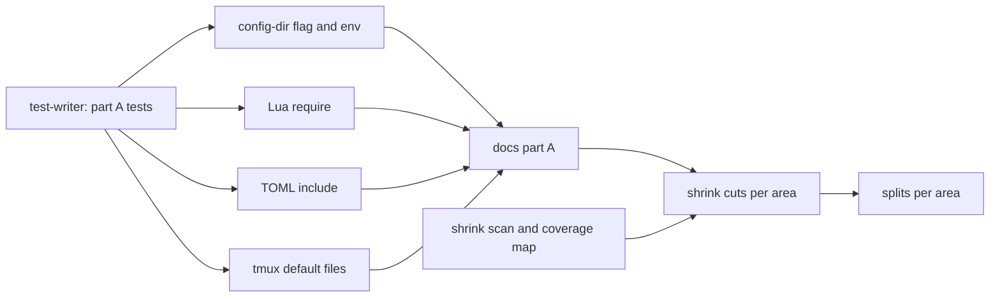

# Plan: config folder, split configs, tmux.conf, shrink

**Spec:** docs/specs/2026-11-25-config-dir-and-shrink.md
**Check (every task):** `cargo fmt --check && cargo clippy --all-targets -- -D warnings && cargo test && bats tests/cli.bats`, plus `just docs` clean for doc tasks; `scripts/ci-local.sh` before a PR if GitHub Actions is down, with GROFE and TMUX unset and a private TMPDIR.

## PR 1: config (branch feat/config-dir)

| Task | Owns | Covers |
|---|---|---|
| TW | tests/config_dir.rs, tests/lua_require.rs, tests/tmux_default_conf.rs, unit test blocks in the files below, tests/cli.bats | t1-t12, failing first |
| T1 | src/main.rs (flag), src/config_glue.rs, src/config/mod.rs, src/layout_glue.rs, __config-file handler | A1-A5 |
| T2 | src/lua/runtime.rs, src/lua/api.rs, src/server/lua_host.rs | A6-A9 |
| T3 | src/config/load.rs | A10 |
| T4 | src/server/dispatch/options/reload.rs, src/server/dispatch/options/source_file.rs, src/server/mod.rs (startup source), src/compat/mod.rs | A11-A12 |
| T5 | docs/book/src/configuration.md, docs/book/src/lua.md, README if needed | A13-A14 |

- T1 to T4 own disjoint files and run in parallel after TW.
- If two tasks need `src/main.rs`, T1 owns it and the other reports the line it needs.

## PR 2..n: shrink (one branch per area)

- S0 runs in a scratch worktree:
  - `shrink-anything scan`, plus a coverage map (`cargo llvm-cov --summary-only`, or the uncovered list).
  - Output: areas ranked by removable lines, and the untested areas that need extra care (B4).
- Areas, each its own PR:
  - `cmd` and `compat` (with `import_tmux`)
  - `server/copy` and `server/prompt`
  - `server` UI (`menu`, `status`, `mouse`, `graphics`, `passthrough`)
  - `server` core (`pane`, `layout`, `model`, `hooks`, `dispatch`)
  - `config`, `lua`, `agents`, `remote`, `control_mode` and the rest
- Each area:
  - Run `shrink-anything cut -- <check>`.
  - Merge duplicates by hand from `.shrink/TASK.md`.
  - Run `shrink-anything verify`.
  - The PR body carries `shrink-anything report` and the B4 reasons.

## PR n+1..: splits (one branch per area, same areas)

- 47 files are over 800 lines today (80k lines in all).
- Split by responsibility into submodules, with moves only (C2).
- Check with `git diff --color-moved=zebra`.

## Review and land

- Every PR gets a fresh `lifecycle:reviewer`, then CI goes green on Linux and macOS, then the merge.
- After the last PR, run `just gate`, then cut the v0.6.0 release, but only on request.
